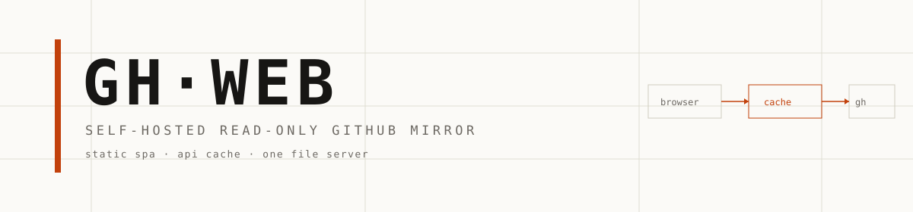

# GH·WEB



一个跑在自己机器上的 GitHub 只读镜像。打开网页，贴上自己的 Personal Access Token，就能翻仓库、看 diff、读 issue、处理通知——比 github.com 快不少，而且不加载 GitHub 的任何前端脚本。

我平时用它做两件事：手机上临时查代码，网络不好的时候看 PR。token 只存在浏览器里，服务端不碰。

<!-- 截图位置：把界面截图存成 docs/screenshot.png，然后去掉下面这行的注释 -->
<!--  -->

## 跑起来

需要 Node.js 18 或更高版本。

```bash
git clone https://github.com/lszyk26/gh-web.git
cd gh-web
node server.js
```

打开 `http://localhost:8787/`，填入 GitHub Token 就能用。

只是本机用，到这里就结束了。要放到公网，至少加一个口令：

```bash
GHW_PASSWORD='你的口令' node server.js
```

口令留空就是不设防，别这样直接暴露到公网。

## 三种跑法

### 手机（Termux）

Termux 请装 F-Droid 版或 GitHub Release 版，应用商店里的那个已经停更。

```bash
pkg update && pkg install -y nodejs-lts git

git clone https://github.com/lszyk26/gh-web.git
cd gh-web

GHW_PASSWORD='你的口令' bash deploy/termux.sh
```

脚本会检查 Node 版本、申请唤醒锁，然后直接起服务。

- 手机浏览器：`http://127.0.0.1:8787/`
- 同一 WiFi 下的电脑：`http://<手机内网 IP>:8787/`，IP 在「设置 → 关于手机 → 状态信息」里能看到

想让它后台常驻：

```bash
nohup node server.js > gh-web.log 2>&1 &
termux-wake-lock          # 息屏后不被系统冻结
```

Termux 被系统清理或卸载时，整个 home 目录都会没，不要把唯一一份东西放在手机里。

### 电脑（Windows / macOS / Linux）

先装 [Node.js](https://nodejs.org/)，18 以上。

macOS / Linux：

```bash
git clone https://github.com/lszyk26/gh-web.git
cd gh-web
GHW_PASSWORD='你的口令' node server.js
```

Windows PowerShell：

```powershell
git clone https://github.com/lszyk26/gh-web.git
cd gh-web
$env:GHW_PASSWORD = "你的口令"
node server.js
```

Windows CMD：

```cmd
set GHW_PASSWORD=你的口令
node server.js
```

不想每次都带一长串环境变量，就复制 `.env.example` 成 `.env`，把口令写进去，之后直接 `node server.js`。手机、电脑、服务器都认这个文件。

局域网里别的设备访问 `http://<这台电脑的 IP>:8787/`。Windows 第一次运行会弹防火墙提示，允许「专用网络」就行。

### 服务器

#### Node + systemd

```bash
sudo git clone https://github.com/lszyk26/gh-web.git /opt/gh-web
cd /opt/gh-web

sudo cp .env.example .env
sudo sed -i "s/change-me/换成你的口令/" .env
sudo chmod 640 .env
sudo chown -R www-data:www-data /opt/gh-web

sudo cp deploy/gh-web.service /etc/systemd/system/
sudo systemctl daemon-reload
sudo systemctl enable --now gh-web
```

服务默认监听 `0.0.0.0:8787`。要绑域名和 HTTPS，在前面放一层 nginx 或 Caddy。

#### Docker

```bash
git clone https://github.com/lszyk26/gh-web.git
cd gh-web
GHW_PASSWORD='你的口令' docker compose up -d
```

不用 compose 也行：

```bash
docker build -t gh-web .
docker run -d --name gh-web -p 8787:8787 \
  -e GHW_PASSWORD='你的口令' \
  --restart unless-stopped gh-web
```

镜像基于 `node:22-alpine`，不跑 `npm install`（运行时零依赖），构建很快。容器自带 `/healthz` 健康检查。

#### nginx / Caddy 反代

Node 只监听 `127.0.0.1:8787`，TLS 交给前面那层。模板在 `deploy/nginx-proxy.conf`：

```bash
sudo cp deploy/nginx-proxy.conf /etc/nginx/conf.d/zz-gh-web.conf
sudo sed -i 's/gh.example.com/你的域名/g' /etc/nginx/conf.d/zz-gh-web.conf
sudo certbot --nginx -d 你的域名
sudo nginx -t && sudo systemctl reload nginx
```

Caddy 更省事，`Caddyfile` 两行：

```
gh.example.com {
    reverse_proxy 127.0.0.1:8787
}
```

配置文件名建议带 `zz-` 前缀。nginx 按 `conf.d` 字母序加载，**第一个**监听 80 端口的 `server` 会顺带成为该端口的默认服务器；名字排太前会接管所有没匹配上的 Host，把别的站点一起改了行为。

#### 生产配置（可选）

`deploy/gh-web.conf` 是我自己站点在用的那套：nginx 直接反代 `api.github.com`，用 `proxy_cache` 把响应落到磁盘，静态文件也由 nginx 直出，比走 Node 中转再快一点。它依赖一个额外的免密登录服务（`auth_request`），不是开箱即用，适合想照着改的人。

配套的 `deploy/install.sh` 是幂等的，域名和路径从环境变量传进去：

```bash
GHW_DOMAIN=gh.example.com sudo -E bash deploy/install.sh              # 安装 / 更新
GHW_DOMAIN=gh.example.com sudo -E bash deploy/install.sh --with-cert  # 首次签证书
```

## 配置

环境变量，也可以写进 `.env`：

| 变量 | 默认 | 说明 |
|---|---|---|
| `PORT` | `8787` | 监听端口 |
| `HOST` | `0.0.0.0` | 监听地址，只给本机用可设 `127.0.0.1` |
| `GHW_PASSWORD` | 空 | 访问口令，留空不设防 |
| `GHW_ROOT` | `./web` | 站点根目录 |
| `GHW_API_ORIGIN` | `https://api.github.com` | 上游地址，可以指向别的反代 |
| `GHW_CACHE_TTL` | `300` | API 缓存秒数 |
| `GHW_CACHE_MAX_MB` | `128` | API 内存缓存上限 |
| `GHW_UPSTREAM_TIMEOUT` | `20000` | 上游超时，毫秒 |
| `GHW_TLS_CERT` / `GHW_TLS_KEY` | 空 | 直接由 Node 提供 HTTPS 时用 |

口令有两种验证方式，任选其一：

- Cookie：访问 `/login` 输一次，下发一年有效的 HttpOnly Cookie
- Basic Auth：用户名随意，密码是 `GHW_PASSWORD`，方便 `curl -u`

`/logout` 清 Cookie，`GET /healthz` 探活。

## HTTPS

按省事程度排：

1. Caddy：自动申请和续期，两行配置
2. nginx + certbot：`deploy/nginx-proxy.conf` 已经按这个套路写好
3. Node 直接上 TLS：设 `GHW_TLS_CERT` / `GHW_TLS_KEY`，证书自己续

## 使用

1. 在登录页填 GitHub 的 Personal Access Token，不是账号密码
2. 需要 `repo`、`read:user`、`notifications` 三个权限，登录页有快捷创建链接
3. token 存在浏览器 `localStorage`，由前端发给 `api.github.com`（经本地代理转发），服务端不落盘、不打日志

只看不写不需要 `repo`。发表评论、合并 PR、标记通知已读才需要，这些操作会**真实写入 GitHub**，界面上都有二次确认。

## 它为什么快

github.com 慢在几处：整页脚本要现场解析执行、接口请求一个接一个串行、头像徽章这些杂项请求拖后腿。

这里的做法：

| 手段 | 实测效果 |
|---|---|
| 页面和前端资源全部本地直出 | 静态资源毫秒级，不加载 GitHub 任何脚本 |
| 反向代理层缓存 `api.github.com` | 命中 8–14 ms，直连约 90 ms，约 8 倍 |
| 内存缓存 + 请求去重 | 同一份数据一次会话只回源一次 |
| 只渲染可见内容 | 大文件、二进制、超长 diff 都有降级 |

缓存层有三个坑，都踩过了：

1. **不能直接收 `Authorization` 头**。浏览器发 `Authorization: Bearer <PAT>`，而站点的口令验证也用这个头，nginx 会先拿它去做口令校验，请求直接 401。所以前端改发自定义头 `X-GH-Token`，由服务端翻成 `Bearer` 转发。
2. **缓存键里不能放原始 token**。落盘缓存会把键明文写进文件（`KEY: gh|ghp_xxx|GET|/user`）。前端先在本地算一个不可逆摘要（FNV-1a 双路，16 个十六进制字符）放进 `X-GH-Cache-Bucket`，缓存键只用摘要。不同凭证的缓存分得开，又不留凭证。
3. **必须显式忽略上游的 `Cache-Control: private`**。GitHub 的响应都带这个头，不忽略的话什么都缓存不上。

## 目录结构

```
浏览器 ──► 你的域名 ──┬─ 静态资源：web/ 本地直出
   (可选口令)          └─ /api/*：缓存层 ──► api.github.com
                                  命中则毫秒返回，未命中回源并缓存
```

前端是零构建的 Vue 3 单页应用，`vendor/vue.global.prod.js` 从本地加载，视图拆成独立文件按需引入，没有打包步骤，改完刷新就生效。

```
gh-web/
├── server.js                自包含服务器（静态 + API 代理 + 口令）
├── web/
│   ├── index.html           外壳 + 脚本装载顺序
│   ├── styles/main.css      设计系统（全部样式）
│   ├── app/
│   │   ├── util.js          格式化 / markdown / 本地存储 / 提示条
│   │   ├── api.js           token 保管 + 缓存传输 + 全部 GitHub 接口
│   │   ├── components.js    图标集 + 复用组件（代码块、diff、分页器…）
│   │   ├── app.js           hash 路由 + 侧边栏 + 顶栏 + 挂载
│   │   └── views/*.js       各页面视图，一个文件一个页面
│   └── vendor/              vue / highlight.js / marked（本地副本）
├── deploy/
│   ├── termux.sh            手机一键启动
│   ├── gh-web.service       systemd 服务
│   ├── nginx-proxy.conf     nginx 反代模板
│   ├── gh-web.conf          生产用 nginx 直连配置（进阶）
│   ├── install.sh           幂等安装脚本
│   ├── rotate.sh            轮换访问口令 / 会话密钥
│   └── bump.sh              递增前端资源版本号
├── tests/                   模板编译、路由渲染、图片改写、移动端回归
├── Dockerfile
├── compose.yaml
└── .env.example
```

## 安全

- token 只存在浏览器 `localStorage`，服务端从不接收、不落盘、不打日志
- 口令可选但公网必备。Cookie 值是 `HMAC-SHA256(口令, 固定串)`，不是口令本身；换口令等于让所有设备立即失效
- 缓存按凭证摘要分桶，不会把 A 的响应喂给 B
- 静态文件有目录穿越防护，`/api` 只转发白名单请求头
- 生产 nginx 配置里 `access_log off`，basic auth 用户名和请求路径都不留痕
- 两个限流区（只在生产 nginx 配置里）：站点 30 r/s burst 100，只用来拦口令爆破——首屏要并发拉 31 个资源，设太小自己人先吃 503；API 6 r/s burst 20，防止手滑打爆 5000/h 额度。命中返回 429 而不是 503，方便和「服务挂了」区分

## 开发与测试

改前端不用构建，刷新就行。跑测试要先装一次开发依赖：

```bash
npm install                        # jsdom + Vue 编译器

node tests/compile-check.js        # 模板语法
node tests/render-check.js         # jsdom 跑全部路由 + 内容断言
node tests/render-check.js '#/some/route'
node tests/img-check.js            # Markdown 相对图片/链接的改写
node tests/mobile-check.js         # 375px 视口下的列表行回归
node tests/server-check.js         # 服务器端到端：静态/口令/代理/缓存（23 项断言）
node tests/root-check.js           # 多根视图清单（提示用）
```

`render-check.js` 用 jsdom 挂载真实 DOM、喂假数据，逐条路由检查「无控制台错误 + 关键内容出现」。它抓到过真 bug：模板字符串里 `\/` 的反斜杠被吃掉导致正则非法，还有 `window.VIEWS` 在视图脚本加载时还不存在。

### 改完前端记得递增版本号

生产 nginx 给 js/css/字体发的是 `Cache-Control: public, max-age=604800, immutable`，7 天强缓存，浏览器不会回源校验。所以改完 `web/` 下任何文件都要换版本号：

```bash
bash deploy/bump.sh            # 用时间戳
bash deploy/bump.sh 20261108f  # 或指定
```

`bump.sh` 把 `index.html` 里所有 `?v=<旧版本>` 换成新的。静态文件由服务器直接从磁盘读，不用重启。

> 首版给资源发了 `immutable` 却没加版本号，改完前端浏览器一直用旧 JS，出现「图标不显示 / 过渡动画消失 / 新旧代码混用」，而且极难排查。

## 能做和不能做

能做：仓库浏览、目录树与文件查看（语法高亮 + Markdown 渲染）、提交历史与单提交 diff、议题与 PR 的列表/详情/时间线/评论、评审状态、PR 文件变更与检查项、分支与标签、Release 与附件下载、代码和议题搜索、用户/组织主页、星标、通知（可标已读）、Actions 运行与任务列表、两个引用之间的比较。

做不了：Actions 实时日志流、Codespaces、Copilot、Discussions、Projects、Marketplace、完整的账号设置后台、Web IDE。这些依赖 GitHub 私有接口或前端专有协议，没有公开 API。

会真的写到 GitHub 的操作：评论、开关议题、合并/关闭 PR、加/取消星标、标记通知已读。

## 界面为什么长这样

没跟现在流行的那套：没有渐变、没有玻璃拟态、没有圆角大卡片堆叠、没有 emoji、没有紫色。

走的是「工程图纸」路线：暖纸底 `#fbfaf7` 配墨黑字 `#171614`，用 1px `#e0ddd4` 的细描边代替阴影分层，等宽字体 JetBrains Mono 承担所有数字和标识符，保证列对齐；唯一的强调色是烧橙 `#c2410c`，只用在「当前项」和「需要你注意」的地方。

`tests/` 里有个配色审计脚本（HSV 判定 + emoji 码点扫描），当前结果：紫色 0 处、渐变 0 处、emoji 0 处。

## 移动端

### 列表行最容易踩的坑

`.row-side`（星标/复刻/时间/按钮）是 `flex:none`，不收缩。窄屏上它会把左边 `.row-main` 挤到只剩一个字的宽度，表现为仓库名显示成 `o…`、描述被压成竖排。

修法在 `@media(max-width:680px)`，让 `.row-side` 整体换到第二行：

```css
.row{flex-wrap:wrap}
.row-side{flex:1 1 100%; order:9; justify-content:flex-start}
```

手机上标题也改成允许折行（`white-space:normal`），仓库名普遍长，省略号会丢信息。`@media(max-width:420px)` 再隐藏复刻数（`.u-fork`）。

新增列表页时复用 `.row` / `.row-main` / `.row-side` 这套结构，否则会重新踩。

### 顶栏

手机上用 `.hide-sm` 隐藏次要读数（缓存命中率、额度条），只留面包屑和刷新按钮，避免一行塞太多东西。

### 测试

`tests/mobile-check.js` 把视口固定成 375px（iPhone SE / 12 mini 级），渲染 `#/trends`、`#/repos`、`#/`，断言列表行结构完整。这是个回归测试，改列表行结构或 CSS 后被挤压会立刻暴露。

## 踩过的坑

### Markdown 里的相对图片和链接

README 写相对路径是 GitHub 上的常规写法：

```html

```

但 SPA 里浏览器按当前页面地址解析，会去要 `https://你的站点/<owner>/<repo>/assets/...`，命中 SPA 兜底，图片全破。

做法在 `util.js` + `components.js`：

- `U.rewriteImg(html)` / `U.rewriteLinks(html)` 把相对路径改写掉：图片指向 `raw.githubusercontent.com/<o>/<r>/<ref>/<path>`，链接指向站内代码路由 `#/<o>/<r>/code/blob/<ref>/<path>`（README 里写死的本仓 GitHub 链接也拉回站内）
- 在 `U.md()` 返回前统一调用，必须在 marked 解析之后
- 仓库上下文由 `<markdown>` 组件的 `owner` / `repo` / `branch` 属性传入

> 那个属性别叫 `ref`。`ref` 是 Vue 的保留属性，写在组件上不会作为 prop 传进去，只会静默丢失，表现是「上下文永远为空、图片照样破」。

> `tests/render-check.js` 里必须补 `w.TextDecoder`。jsdom 的 window 不带它，而 `repo.js` 用它解 base64 README，缺了会被 catch 成空串，静默落到「这个仓库没有 README」，测试却因为页面里另有「README」字样而假通过。

### 多根模板与过渡

`run / commit / compare / issue / pull / user` 这几个详情页的模板是 `v-if 加载态` / `v-else-if 错误态` / `v-else 正文` 三个并列根。

Vue 的 `<transition>` 要求直接子节点单根，否则过渡会静默失效，生产版还不告警。所以 `app.js` 里过渡内套了一层单根 `.view-host` 当 carrier。

`tests/root-check.js` 会列出当前的多根视图，新增页面时可以照着看。

### 视图脚本漏引

`render-check.js` 是从 `app/views/` 读目录加载脚本的，所以它发现不了「`index.html` 漏引某个 view」。历史上 `views/user.js` 就漏引过，用户主页错落成了概览页。新增视图后确认 `index.html` 里也加了对应的 `<script>`。

## 热门榜是怎么做的

GitHub 没有官方 trending 接口（github.com/trending 是网页端私有渲染），这一页用搜索语法近似：

| 模式 | 搜索式 | 排序 |
|---|---|---|
| 新晋 | `created:>=<窗> stars:>=N fork:false archived:false` | 星标 |
| 活跃 | `pushed:>=<窗> stars:>=N fork:false archived:false` | 最近更新 |

时间窗：今日 / 本周(7d) / 本月(30d) / 近 90 天。

两个坑：

1. **不能用 `stars:<=N` 收窄**。GitHub 搜索不认，会把它当普通文本词去匹配，结果是暴涨不是收窄（实测 11 万 → 3.4 亿）。区间要写 `stars:a..b`。
2. **「活跃」不能同时写 `created:>=窗` 和 `pushed:>=窗`**。窗内新建的仓库推送时间必然也在窗内，条件完全冗余，实测结果和「新晋」一字不差。真正的活跃只看 `pushed:>=窗`，再配星标门槛滤掉索引和机器人仓库，按 `sort=updated` 排。

搜索接口的限流是单独算的，也严：未登录约 10 次/分，登录后约 30 次/分，远低于其余接口的 5000 次/小时。所以这页不自动轮询，切筛选才发请求；命中 403/429 时给「等一分钟再试」，而不是直接把 403 抛出来。

## 许可

MIT
